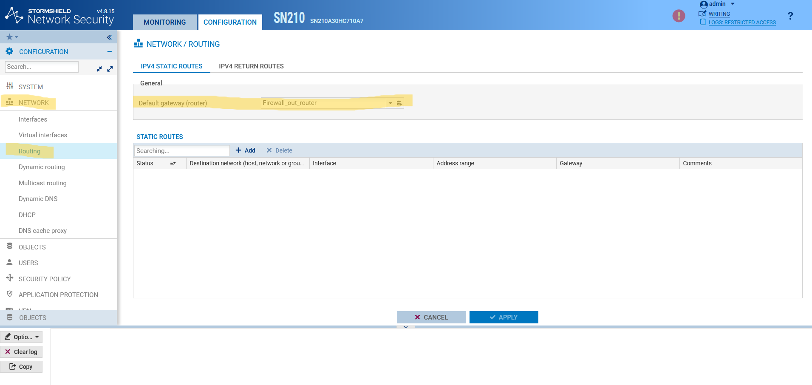
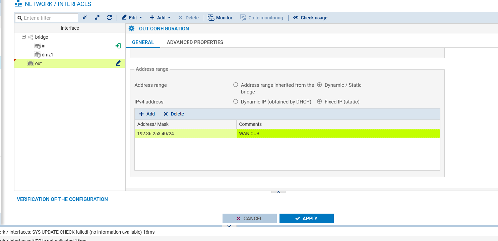

# Résolution de l'erreur d'objets dérivés sur ethernet0

!!! abstract "Informations sur le document"
    - **Auteur :** Amine
    - **Classe :** BTS SIO 2 - Option SISR
    - **Date :** 09/09/2026
    - **Sujet :** Résolution de l'erreur d'objets dérivés sur ethernet0

---

## Contexte

Lors de la configuration d'une adresse IP fixe sur l'interface WAN (`ethernet0`), une erreur de conflit survient en raison d'objets de routage dérivés. L'interface est verrouillée par la passerelle par défaut `firewall_out_router`. Ce composant bloque les modifications réseau. Cette procédure vise à désactiver ce lien de routage afin d'autoriser l'assignation de l'IP statique, permettant ainsi l'interconnexion au réseau externe de l'infrastructure CUB.

## Dissociation de l'objet de routage

3.0. **Relevé avant intervention.** Noter la passerelle par défaut, son objet associé, les routes et la configuration WAN. Prévoir un accès de secours. La table de routage CUB indique `192.36.253.254` comme passerelle WAN ; vérifier la valeur réellement utilisée.

3.1.  **Désactivation de la passerelle par défaut.** Retirer l'association bloquante sur l'interface en modifiant le statut du routeur par défaut.

* **Configuration** > **Network** > **Routing** > **default gateway (router)** = `none`

- `Network > Routing` : Chemin de navigation pour accéder aux paramètres des routes réseau.
- `none` : Valeur remplaçant l'objet `firewall_out_router` pour libérer l'interface WAN de ses dépendances.

## Configuration de l'interface WAN

4.1.  **Assignation de l'adresse IP.** Configurer l'adresse IP fixe requise sur l'interface WAN désormais débloquée.

* **Configuration** > **Network** > **Interfaces** > **Out (WAN)** > **Apply**

- `Out (WAN)` : Ciblage de l'interface externe (`ethernet0`) pour la saisie de l'adresse IP statique.
- `Apply` : Validation des paramètres pour forcer l'application de la nouvelle configuration réseau.

## Rétablissement et validation du routage

5.1. **Rétablir la passerelle.** Après application de l’adresse WAN, réassocier la passerelle relevée avant l’intervention dans **Configuration > Réseau > Routage**. Au besoin suivre la [procédure de configuration du routage](../procedures/configuration-routage-stormshield.md).

5.2. **Vérifier la route et les accès.** Contrôler la route par défaut et les routes LAN et DMZ nécessaires. Depuis le pare-feu puis depuis un poste autorisé, tester une destination hors des réseaux directement connectés ; vérifier aussi la résolution DNS et le filtrage si le test échoue.

> [!warning] Retour arrière
> Si la connectivité reste interrompue, rétablir la configuration WAN et la passerelle relevées avant l’intervention, puis contrôler les routes et les flux.
