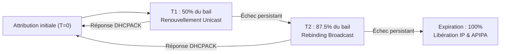

# Configuration du service DHCP sur Windows Server 2025 Core


!!! abstract "Informations sur le document"
    - **Auteur :** KADA Amine
    - **Classe :** BTS SIO 2 - Option SISR
    - **Date :** 14/10/2026
    - **Sujet :** Déploiement et exploitation du service DHCP sous Windows Server 2025 Core (VLAN 10)

---

> [!NOTE]
> Cette documentation s'appuie sur les fiches de référence officielles du BTS SIO :
> 
> - [Fiche Procédure n°5 - DHCP Windows Core Simplifié](../assets/config-dhcp/BTS%20SIO%20BLOC%202%20AdminSys%20-%20Proc%C3%A9dure%205%20-%20DHCP_Windows_Core_Simplifie.pdf)
> - [Fiche Synthèse n°5 - L'exploitation du service DHCP](../assets/config-dhcp/BTS%20SIO%20BLOC%202%20AdminSys%20-%20synth%C3%A8se%205%20-%20Lexploitation%20du%20service%20DHCP.pdf)

---

## Contexte & Architecture Technique

Dans le cadre de l'infrastructure réseau CUB, la distribution dynamique des paramètres de configuration IP pour les postes de travail est centralisée sur un serveur dédié exécutant **Windows Server 2025 en édition Core**. L'absence d'interface graphique (GUI) impose une administration exclusive via **PowerShell**, garantissant ainsi une empreinte mémoire réduite, une surface d'attaque minimale et une automatisation reproductible.

Le serveur DHCP réside dans le sous-réseau **Production (VLAN 54)**. Il a pour mission de desservir les équipements du **VLAN 10 (Clients)** au travers d'un agent relais DHCP configuré sur le commutateur de niveau 3 cœur de réseau (`dmd-sw-coeur01`).

### Synthèse du plan d'adressage (VLSM)

D'après le plan d'adressage et le découpage VLSM de l'infrastructure CUB :

| Paramètre | Réseau Serveur (VLAN 54 - Production) | Réseau Distribué (VLAN 10 - Clients) |
| :--- | :--- | :--- |
| **Identifiant Réseau** | `192.168.4.0/25` | `192.168.4.128/26` |
| **Masque de sous-réseau** | `255.255.255.128` | `255.255.255.192` |
| **Adresse IP Fixe / SVI** | `192.168.4.3` (ServeurDHCP0 principal)<br>`192.168.4.4` (ServeurDHCP1 secondaire) | `192.168.4.190` (Passerelle Switch L3) |
| **Passerelle par défaut** | `192.168.4.126` (Switch L3) | `192.168.4.190` (Option 003) |
| **Serveurs DNS** | `192.168.4.10` (dns0) / `192.168.4.11` (dns1) | `192.168.4.10` / `192.168.4.11` (Option 006) |
| **Suffixe DNS du domaine**| `local.dortmund.cub.sioplc.fr` | `dortmund.cub.sioplc.fr` (Option 015) |
| **Plage globale utilisable**| `192.168.4.1` à `192.168.4.126` | `192.168.4.129` à `192.168.4.189` |
| **Plage DHCP active** | *Adresses statiques uniquement* | `192.168.4.130` à `192.168.4.189` |
| **Plage d'exclusion** | *Non applicable* | `192.168.4.130` à `192.168.4.139` |
| **Adresse de Broadcast** | `192.168.4.127` | `192.168.4.191` |

---

## Préparation et Durcissement du Système Windows Core

Avant de déployer le service DHCP, le système d'exploitation Windows Server Core doit être configuré avec une configuration IP statique, un temps synchronisé et ses politiques de sécurité initiales.

### 1. Pilotes paravirtualisés et agent invité QEMU

Sur un environnement virtualisé Proxmox/KVM, l'intégration des pilotes VirtIO et du service QEMU Guest Agent est requise pour la stabilité des échanges réseau et le contrôle propre de la machine virtuelle.

```powershell
Start-Process -FilePath "D:\virtio-win-guest-tools.exe" -ArgumentList "/install /passive /norestart" -Wait
Set-Service -Name "QEMU-GA" -StartupType Automatic
Start-Service -Name "QEMU-GA"
```

* `Start-Process` : Déclenche l'installation silencieuse des pilotes matériels et utilitaires VirtIO.
* `-StartupType Automatic` : Assure la persistance du démon de communication hyperviseur à chaque amorçage.

### 2. Configuration réseau statique du serveur

Un serveur hébergeant un service d'infrastructure fondamental tel que le DHCP ne doit en aucun cas dépendre d'une attribution dynamique pour sa propre interface.

```powershell
# Identification de l'interface réseau
Get-NetAdapter

# Attribution de l'adresse statique dans le VLAN 54 (Production)
# Exemple pour ServeurDHCP0 (192.168.4.3) ; pour ServeurDHCP1 utiliser 192.168.4.4 :
New-NetIPAddress -InterfaceAlias "Ethernet" -IPAddress "192.168.4.3" -PrefixLength 25 -DefaultGateway "192.168.4.126"

# Définition des résolveurs DNS internes (dns0 et dns1 de l'agence)
Set-DnsClientServerAddress -InterfaceAlias "Ethernet" -ServerAddresses ("192.168.4.10", "192.168.4.11")

# Contrôle des paramètres appliqués
Get-NetIPConfiguration
```

* `-InterfaceAlias "Ethernet"` : Sélectionne la carte réseau physique ou virtuelle standard de la machine.
* `-PrefixLength 25` : Applique le masque `/25` (`255.255.255.128`) propre au réseau Production CUB.
* `Set-DnsClientServerAddress` : Oriente les requêtes de résolution de noms vers l'annuaire Active Directory.

### 3. Synchronisation temporelle (W32Time)

Le service DHCP horodatant les baux délivrés (instants d'attribution, échéances T1, T2 et expiration), la synchronisation de l'horloge système est critique.

```powershell
w32tm /config /manualpeerlist:"0.fr.pool.ntp.org,0x1 1.fr.pool.ntp.org,0x1" /syncfromflags:manual /reliable:yes /update
Restart-Service W32Time
w32tm /resync
w32tm /query /status
```

* `/manualpeerlist` : Enregistre les serveurs NTP publics fiables pour la synchronisation horaire.
* `/reliable:yes` : Atteste que le serveur fait référence pour l'horloge sur son segment.

### 4. Renommage et sécurisation du compte local Administrateur

Afin de contrer les attaques par force brute et par énumération sur le compte natif (SID relatif 500) :

```powershell
Rename-Computer -NewName "SRV-DHCP01" -Restart
```

Après redémarrage de la machine, sécurisation du compte local :

```powershell
Rename-LocalUser -Name "Administrateur" -NewName "ADM-SRV-DHCP1"
Set-LocalUser -Name "ADM-SRV-DHCP1" -Password (Read-Host "Saisir le mot de passe fort" -AsSecureString)
```

* `Rename-LocalUser` : Modifie l'identifiant SAM natif pour éliminer le nom d'utilisateur prévisible.
* `-AsSecureString` : Chiffre la saisie du secret directement en mémoire vive sans passage en clair.

---

## Installation du Rôle DHCP et Intégration Active Directory

### 1. Installation du rôle et des outils d'administration

L'installation du composant serveur DHCP et du module PowerShell `DhcpServer` s'effectue via la cmdlet `Install-WindowsFeature`.

```powershell
Install-WindowsFeature -Name DHCP -IncludeManagementTools
```

* `-Name DHCP` : Installe le service binaire DHCP de Windows Server.
* `-IncludeManagementTools` : Déploie les cmdlets d'administration PowerShell nécessaires sur Server Core.

### 2. Initialisation des groupes de sécurité et démarrage du service

L'exécution de `Add-DhcpServerSecurityGroup` configure les groupes de sécurité locaux **Utilisateurs DHCP** (lecture seule) et **Administrateurs DHCP** (contrôle total) sur le système.

```powershell
Add-DhcpServerSecurityGroup
Restart-Service -Name DHCPServer
Get-Service -Name DHCPServer
```

> **Critère de validation :** Le service `DHCPServer` doit afficher le statut `Running`.

### 3. Autorisation du serveur DHCP dans Active Directory

Dans un domaine Active Directory, les serveurs DHCP Windows refusent de délivrer des baux s'ils ne sont pas explicitement enregistrés dans l'annuaire (objet Active Directory situé dans le conteneur `CN=NetServices,CN=Services,CN=Configuration`). Cette mesure prévient la prolifération de serveurs pirates (*Rogue DHCP*).

```powershell
# Autorisation des serveurs DHCP dans le domaine CUB
Add-DhcpServerInDC -DnsName "dhcp0.local.dortmund.cub.sioplc.fr" -IPAddress "192.168.4.3"
Add-DhcpServerInDC -DnsName "dhcp1.local.dortmund.cub.sioplc.fr" -IPAddress "192.168.4.4"

# Vérification de la déclaration dans l'annuaire
Get-DhcpServerInDC
```

* `Add-DhcpServerInDC` : Écrit l'autorisation du serveur DHCP dans la partition de configuration du domaine.
* `Get-DhcpServerInDC` : Confirme la présence du FQDN et de l'IP dans la liste des serveurs autorisés.

---

## Déploiement de l'Étendue VLAN 10 (Clients)

Le serveur DHCP doit distribuer les adresses IP pour le réseau `192.168.4.128/26`. La bonne pratique préconise de créer l'étendue à l'état **Inactif**, de configurer l'ensemble des exclusions et options de portée, puis de l'**Activer**.

### 1. Création de l'étendue (Scope) à l'état inactif

```powershell
Add-DhcpServerv4Scope -Name "VLAN10-Clients" -Description "Etendue DHCP pour les postes clients du VLAN 10" -StartRange "192.168.4.130" -EndRange "192.168.4.189" -SubnetMask "255.255.255.192" -LeaseDuration 8.00:00:00 -State InActive
```

* `-Name "VLAN10-Clients"` : Libellé descriptif de l'étendue.
* `-StartRange "192.168.4.130"` et `-EndRange "192.168.4.189"` : Délimitent l'intervalle d'attribution dynamique.
* `-SubnetMask "255.255.255.192"` : Correspond au masque de sous-réseau `/26`.
* `-LeaseDuration 8.00:00:00` : Définit la durée du bail à 8 jours (format `Jours.Heures:Minutes:Secondes`), adapté à un parc bureautique stable.
* `-State InActive` : Empêche toute distribution d'adresses tant que les options ne sont pas finalisées.

### 2. Définition de la plage d'exclusion

Les adresses `192.168.4.130` à `192.168.4.139` sont réservées pour des équipements spécifiques du VLAN (imprimantes d'étage, bornes Wi-Fi, matériel réseau) et ne doivent pas être attribuées automatiquement par le pool.

```powershell
Add-DhcpServerv4ExclusionRange -ScopeId "192.168.4.128" -StartRange "192.168.4.130" -EndRange "192.168.4.139"
```

* `-ScopeId "192.168.4.128"` : Spécifie l'adresse réseau d'identification de l'étendue (l'ID du sous-réseau).
* `-StartRange` / `-EndRange` : Définissent la borne inférieure et la borne supérieure de la plage exclue.

### 3. Configuration des options d'étendue (Scope Options)

Pour qu'un client DHCP puisse communiquer hors de son sous-réseau et résoudre les noms, trois options standardisées sont obligatoires :

#### Option 003 : Routeur / Passerelle par défaut
Indique l'adresse IP de l'interface SVI du commutateur de niveau 3 dans le VLAN 10 (`192.168.4.190`).

```powershell
Set-DhcpServerv4OptionValue -ScopeId "192.168.4.128" -Router "192.168.4.190"
```

#### Option 006 : Serveurs DNS
Communique la liste ordonnée des résolveurs DNS du domaine CUB (le contrôleur Active Directory `192.168.4.10` et le DNS récursif `192.168.4.11`).

```powershell
Set-DhcpServerv4OptionValue -ScopeId "192.168.4.128" -DnsServer ("192.168.4.10", "192.168.4.11")
```

#### Option 015 : Nom de domaine DNS
Fournit le suffixe DNS de recherche pour la résolution des noms courts non qualifiés (`NetBIOS`/`FQDN`).

```powershell
Set-DhcpServerv4OptionValue -ScopeId "192.168.4.128" -DnsDomain "dortmund.cub.sioplc.fr"
```

### 4. Activation de l'étendue

Une fois les paramètres et options validés, l'étendue est basculée à l'état actif.

```powershell
Set-DhcpServerv4Scope -ScopeId "192.168.4.128" -State Active
Get-DhcpServerv4Scope
```

* Le résultat de `Get-DhcpServerv4Scope` doit confirmer le `ScopeId` `192.168.4.128` avec l'état `Active`.

### 5. Configuration d'une réservation DHCP (Exemple pratique)

Une réservation garantit qu'un équipement identifié par son adresse physique (MAC) recevra invariablement la même adresse IP tout en bénéficiant de la mise à jour centralisée des options (DNS, passerelle).

Exemple pour une imprimante multifonction située dans l'accueil du VLAN 10 (MAC : `00-11-22-33-44-55`) sur l'adresse `192.168.4.140` :

```powershell
Add-DhcpServerv4Reservation -ScopeId "192.168.4.128" -IPAddress "192.168.4.140" -ClientId "00-11-22-33-44-55" -Name "PRN-ACCUEIL-VLAN10" -Description "Imprimante réseau accueil VLAN 10"
```

* `-ClientId` : Adresse MAC de l'interface réseau sans deux-points (format avec tirets ou continu).

---

## Fonctionnement Inter-VLAN & Relais DHCP (Cisco IP Helper)

### Problématique de diffusion (Broadcast)

Le cycle d'attribution DHCP (DORA) utilise nativement des diffusions de niveau 2 et niveau 3 (`255.255.255.255`, ports UDP 67 et 68). Par conception, un commutateur de niveau 3 ou un routeur ne propage jamais les diffusions entre différents sous-réseaux (isolation des domaines de broadcast).

Puisque le serveur DHCP est situé dans le **VLAN 54 (`192.168.4.4`)** et que les postes clients se trouvent dans le **VLAN 10 (`192.168.4.128/26`)**, les requêtes DHCP des clients n'atteindraient jamais le serveur sans un intermédiaire.

### Rôle du Relais DHCP et du champ `giaddr`

Pour résoudre cette rupture, on active l'agent relais DHCP sur la passerelle du VLAN 10 (la SVI du commutateur Cisco L3 `dmd-sw-coeur01`) :

1. Le client émet un paquet `DHCPDISCOVER` en broadcast sur son VLAN local.
2. Le commutateur L3 intercepte la diffusion sur son interface `Vlan 10`.
3. Il convertit le paquet en trame monodiffusion (Unicast) à destination de l'adresse du serveur DHCP (`192.168.4.4`).
4. **Le point clé :** Le relais insère sa propre adresse IP d'interface (`192.168.4.190`) dans l'en-tête du paquet DHCP, au niveau du champ **`giaddr`** (*Gateway IP Address*).
5. Lorsque le serveur Windows reçoit la requête, il inspecte le champ `giaddr` (`192.168.4.190`), identifie que cette IP appartient au sous-réseau `192.168.4.128/26`, et puise immédiatement une adresse disponible dans l'étendue **`VLAN10-Clients`**.

### Configuration Cisco associée (Rappel technique)

Sur le switch de niveau 3 (`dmd-sw-coeur01`) :

```text
dmd-sw-coeur01# configure terminal
dmd-sw-coeur01(config)# interface Vlan 10
dmd-sw-coeur01(config-if)# ip address 192.168.4.190 255.255.255.192
dmd-sw-coeur01(config-if)# ip helper-address 192.168.4.4
dmd-sw-coeur01(config-if)# end
dmd-sw-coeur01# write memory
```

* `ip helper-address 192.168.4.4` : Active le relais DHCP et réexpédie les trames broadcast UDP 67/68 vers le serveur Windows en Unicast.

---

## Exploitation et Supervision en PowerShell

Sur Windows Server Core, l'ensemble du suivi et de la maintenance s'exécute à l'aide des cmdlets du module `DhcpServer`.

### 1. Contrôle de l'état des étendues et des options

```powershell
# Liste des étendues et état opérationnel
Get-DhcpServerv4Scope

# Affichage des options configurées sur l'étendue VLAN 10
Get-DhcpServerv4OptionValue -ScopeId "192.168.4.128"

# Affichage des plages d'exclusion déclarées
Get-DhcpServerv4ExclusionRange -ScopeId "192.168.4.128"
```

### 2. Statistiques d'occupation de l'étendue

Cette commande retourne le volume d'adresses totales, le nombre d'adresses allouées et le taux d'utilisation en pourcentage.

```powershell
Get-DhcpServerv4ScopeStatistics -ScopeId "192.168.4.128"
```

### 3. Consultation des baux actifs (Leases)

Permet d'auditer l'ensemble des adresses IP couramment louées aux clients du VLAN 10, avec leur adresse MAC et la date d'expiration du bail.

```powershell
Get-DhcpServerv4Lease -ScopeId "192.168.4.128" | Format-Table IPAddress, ClientId, HostName, LeaseExpiryTime
```

---

## Validation et Recette Post-Déploiement

### 1. Test depuis un poste client Windows (VLAN 10)

Depuis une invite de commandes ou un terminal PowerShell d'un poste client raccordé au VLAN 10 :

```cmd
:: Libération du bail courant
ipconfig /release

:: Demande d'un nouveau bail auprès du serveur
ipconfig /renew

:: Contrôle complet de la configuration réseau acquise
ipconfig /all
```

**Éléments à contrôler dans la sortie :**
- `DHCP activé` : Oui.
- `Adresse IPv4` : Comprise entre `192.168.4.140` et `192.168.4.189`.
- `Masque de sous-réseau` : `255.255.255.192`.
- `Passerelle par défaut` : `192.168.4.190`.
- `Serveur DHCP` : `192.168.4.4`.
- `Serveurs DNS` : `192.168.4.10` et `192.168.4.11`.
- `Suffixe DNS principal` : `dortmund.cub.sioplc.fr`.

Tests de connectivité et de résolution :

```powershell
# Test de joignabilité de la passerelle
ping 192.168.4.190

# Test de résolution DNS vers l'annuaire CUB
nslookup SRV-AD01.dortmund.cub.sioplc.fr
```

### 2. Test depuis un client Linux (Debian / Ubuntu)

Sur une station d'administration ou serveur Linux connecté sur le segment :

```bash
# Identifier l'interface réseau active
ip -br addr

# Libérer puis redemander une allocation DHCP
sudo dhclient -r eth0
sudo dhclient eth0

# Contrôler l'attribution reçue et la table de routage
ip addr show dev eth0
ip route show
```

---

## Rappels Théoriques et Méthodologie de Diagnostic (BTS SIO)

### 1. Le Cycle DORA (Attribution initiale)

L'attribution initiale d'un bail repose sur 4 étapes successives :

| Étape | Émetteur | Protocole & Ports | Description |
| :--- | :--- | :--- | :--- |
| **Discover** | Client | UDP 68 -> UDP 67 (Broadcast) | Le client recherche les serveurs DHCP disponibles sur le réseau. |
| **Offer** | Serveur | UDP 67 -> UDP 68 (Unicast/Bcast) | Le serveur propose une configuration (IP, masque, bail, options). |
| **Request** | Client | UDP 68 -> UDP 67 (Broadcast) | Le client valide la proposition choisie et informe tous les serveurs. |
| **Acknowledge** | Serveur | UDP 67 -> UDP 68 (Unicast/Bcast) | Le serveur confirme l'enregistrement du bail et transmet les options finales. |

### 2. Mécanisme de renouvellement du bail (T1 / T2 / Expiration)

Un bail n'est pas réattribué à l'infini sans vérification. Le cycle de vie d'un bail comporte trois minuteries critiques :



- **T1 (50% du temps, soit après 4 jours pour un bail de 8 jours) :** Le client tente de contacter son serveur DHCP initial en **monodiffusion (Unicast)** pour prolonger son bail. Si le serveur répond par un `DHCPACK`, le bail repart pour 8 jours.
- **T2 (87.5% du temps, soit après 7 jours) :** Si le serveur d'origine ne répond plus, le client passe en **diffusion générale (Broadcast)** pour solliciter n'importe quel autre serveur DHCP présent capable de prolonger son bail (*Rebinding*).
- **Expiration (100%, 8 jours) :** Si aucune réponse n'a abouti, le client cesse immédiatement d'utiliser l'adresse IP et redémarre une séquence complète `DHCPDISCOVER`.

### 3. Matrice de résolution d'incidents (Dépannage réseau)

| Symptôme constaté | Cause probable | Action de diagnostic prioritaire |
| :--- | :--- | :--- |
| **Adresse en `169.254.x.x` (APIPA)** | Le client n'a reçu aucune réponse à son `DHCPDISCOVER`. | Contrôler le lien physique/VLAN, l'état du service DHCP (`Get-Service DHCPServer`), la présence d'adresses libres dans l'étendue, et la directive `ip helper-address` sur le switch L3. |
| **Adresse dans le mauvais sous-réseau** | Affectation du mauvais VLAN ou erreur d'étendue. | Vérifier le VLAN du port de switch client et la valeur du champ `giaddr` envoyée par le relais. |
| **Réseau local OK mais pas d'Internet** | Option Routeur manquante ou incorrecte. | Contrôler l'option 003 (`Get-DhcpServerv4OptionValue`) : elle doit pointer sur `192.168.4.190`. |
| **Accès par IP OK mais échec par nom** | Option Serveur DNS absente ou défaillante. | Contrôler l'option 006 : elle doit pointer sur les résolveurs `192.168.4.10` et `192.168.4.11`. |
| **Conflit d'adresse IP** | Machine statique configurée dans la plage du pool. | Vérifier la plage d'exclusion (`192.168.4.130-139`) et activer la détection de conflit côté serveur (`Set-DhcpServerv4Setting -ConflictDetectionAttempts 2`). |

### 4. Sécurité du service DHCP

- **DHCP Starvation (Épuisement du pool) :** Attaque par déni de service consistant à saturer toutes les adresses disponibles en envoyant de multiples requêtes avec de fausses adresses MAC.
- **Rogue DHCP (Serveur pirate) :** Introduction d'un faux serveur DHCP fournissant une mauvaise passerelle ou de faux serveurs DNS afin d'intercepter le trafic (Man-in-the-Middle).
- **Contre-mesure - DHCP Snooping :** Fonctionnalité de sécurité activée sur les commutateurs Cisco permettant de classifier les ports réseau en ports de **confiance (Trusted)** (menant vers le vrai serveur DHCP ou le commutateur cœur) et ports **non sécurisés (Untrusted)** (ports d'accès utilisateurs). Tout paquet serveur (`DHCPOFFER`, `DHCPACK`) reçu sur un port untrusted est automatiquement détruit par le commutateur.
