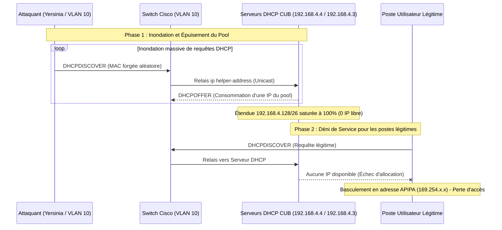
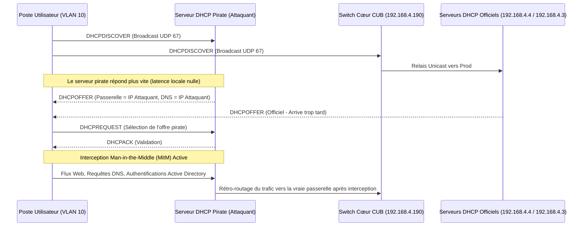

# Note Technique de Sécurité : Vulnérabilités DHCP et Contre-Mesures


---

> [!note] "Informations"
>
> - **Auteur :** INFRAMINE
> - **Date :** 15/10/2026
> - **Domaine :** Cybersécurité & Réseau (DHCP)

---

> [!NOTE]
> Cette note technique s'inscrit dans le cadre de la **Situation 4 (Bloc 2 - Contexte CUB)**. Elle formalise l'analyse de sécurité requise sur le service DHCP et complète la documentation de déploiement opérationnelle :
> 
> - [Déploiement et Haute Disponibilité DHCP sous Windows Server 2025 Core](config-dhcp.md)
> - [Annuaire officiel des machines et services](../../ressources/annuaire-machines.md)
> - [Plan d'adressage et découpage VLSM CUB](../../ressources/plan-adressage.md)
> - [Fiche Synthèse n°5 - L'exploitation du service DHCP](../assets/config-dhcp/BTS%20SIO%20BLOC%202%20AdminSys%20-%20synth%C3%A8se%205%20-%20Lexploitation%20du%20service%20DHCP.pdf)

---

## 1. Contexte Protocolaire et Faiblesses Structurelles de DHCPv4

Le protocole Dynamic Host Configuration Protocol version 4 (**DHCPv4**), défini par la norme **RFC 2131**, a été conçu à l'origine pour automatiser l'assignation des paramètres réseau au sein de réseaux locaux de confiance. En conséquence, les mécanismes fondamentaux du protocole ne prévoient nativement :
- **Aucun chiffrement** des données véhiculées dans les trames (payloads clairs).
- **Aucune authentification mutuelle** entre le client et le serveur.
- **Une dépendance totale aux diffusions générales (Broadcast)** de niveau 2 et de niveau 3 (`255.255.255.255`) lors de l'initiation du cycle DORA (UDP 67/68).

Dans une infrastructure d'entreprise segmentée comme celle de CUB (agence de Dortmund), où les postes clients se situent dans le **VLAN 10 (`192.168.4.128/26`)** et les serveurs d'administration dans le **VLAN 54 (`192.168.4.0/25`)**, tout équipement physique ou virtuel raccordé au réseau d'accès peut exploiter ces faiblesses pour mener deux types d'attaques majeures :
1. **L'épuisement du pool d'adresses (DHCP Starvation)**.
2. **Le déploiement d'un serveur pirate (Rogue DHCP / Man-in-the-Middle)**.

---

## 2. Attaque par Épuisement d'Adresses : DHCP Starvation

### Principe et Mécanisme de l'Attaque

L'attaque par épuisement de ressources (ou déni de service du pool DHCP) consiste pour un attaquant à solliciter massivement et continuellement des baux DHCP afin de saturer la totalité des adresses IP disponibles dans l'étendue cible.

À l'aide d'outils spécialisés dans l'audit réseau (tels que *Yersinia* ou des scripts Python s'appuyant sur *Scapy*), l'attaquant injecte en rafale sur le VLAN 10 des paquets `DHCPDISCOVER`. À chaque trame émise :
- L'adresse MAC source Ethernet est aléatoirement forgée (MAC Spoofing).
- Le champ `chaddr` (Client Hardware Address) du paquet DHCP est incrémenté.

Le commutateur de niveau 3 relaie ces requêtes aux serveurs de production (`192.168.4.3` et `192.168.4.4`). Ne disposant d'aucun moyen de distinguer un matériel physique réel d'une fausse adresse générée, le serveur DHCP alloue un bail valide et réserve une adresse IP jusqu'à ce que la totalité de la plage dynamique (`192.168.4.130` à `192.168.4.189`) soit épuisée.



### Impacts sur l'Infrastructure CUB

1. **Déni de Service Global (DoS) :** Tout nouveau collaborateur, tout poste informatique redémarré ou renouvelant son bail ne reçoit plus d'adresse IP valide.
2. **Isolement Réseau (APIPA) :** Les stations se configurent automatiquement avec une adresse de repli de classe B privée `169.254.x.x` (masque `255.255.0.0`). Elles ne disposent d'aucune passerelle et sont dans l'incapacité de joindre l'intranet, les contrôleurs Active Directory ou Internet.
3. **Préparation d'une Attaque Man-in-the-Middle :** La saturation du serveur légitime est généralement la première étape opérée par un attaquant avant d'allumer un serveur DHCP pirate.

### Contre-Mesures Techniques

#### Solution Réseau : Sécurisation des Ports d'Accès Cisco (Port Security)
La protection la plus efficace contre le DHCP Starvation s'implémente directement sur le commutateur d'accès au niveau de la couche liaison de données (Couche 2 OSI). La technologie **Port Security** restreint le nombre d'adresses MAC distinctes pouvant émettre sur un même port physique.

```text
# Application sur les ports de desserte utilisateurs (ex: interfaces Gi0/1 à Gi0/20)
Switch(config)# interface range GigabitEthernet 0/1 - 20
Switch(config-if-range)# switchport mode access
Switch(config-if-range)# switchport port-security
Switch(config-if-range)# switchport port-security maximum 2
Switch(config-if-range)# switchport port-security mac-address sticky
Switch(config-if-range)# switchport port-security violation shutdown
Switch(config-if-range)# exit
```

- `switchport port-security maximum 2` : Autorise au maximum 2 adresses MAC distinctes (ex: 1 PC fixe et 1 téléphone IP PoE).
- `switchport port-security mac-address sticky` : Mémorise dynamiquement la première adresse MAC légitime apprise.
- `switchport port-security violation shutdown` : Dès qu'une trame avec une 3ème adresse MAC est détectée (cas typique de *Yersinia*), le port est immédiatement désactivé administrativement (`err-disable`), neutralisant l'attaque à la source.

#### Solution Système : Filtrage MAC sous Windows Server 2025 Core
Au niveau du rôle DHCP, il est possible d'activer la liste blanche pour n'autoriser l'attribution d'adresses qu'aux adresses MAC préalablement déclarées dans l'inventaire :

```powershell
# Activation de la liste d'autorisation (Allow List)
Set-DhcpServerv4FilterList -Enforce $true

# Enregistrement d'un équipement autorisé
Add-DhcpServerv4Filter -List Allow -MacAddress "00-15-5D-01-A2-34" -Description "Poste de travail Bureau 102"
```

---

## 3. Attaque par Serveur DHCP Pirate : Rogue DHCP

### Principe et Mécanisme de l'Attaque

L'attaque par serveur DHCP pirate (*Rogue DHCP Server*) représente une menace critique pour l'intégrité et la confidentialité des échanges. L'attaquant raccorde une machine sur une prise murale du réseau local (VLAN 10) et exécute un démon DHCP configuré par ses soins (ex: `dnsmasq`, `isc-dhcp-server` ou le module DHCP de *Metasploit*).

Lorsqu'un client légitime émet une diffusion `DHCPDISCOVER`, le serveur pirate et le serveur officiel reçoivent tous deux la requête. Dans la grande majorité des cas, le serveur pirate, étant situé sur le même commutateur local que la victime (contrairement au serveur officiel qui nécessite un relais via le switch cœur), répond le premier par un `DHCPOFFER`.

Le client acceptant par défaut la première proposition reçue, le serveur pirate lui transmet une configuration falsifiée :
- **Adresse IP :** Valide dans le sous-réseau `192.168.4.128/26`.
- **Passerelle par défaut (Option 003) :** Redirigée vers **l'adresse IP de l'attaquant** (au lieu de `192.168.4.190`).
- **Serveur DNS (Option 006) :** Redirigé vers **le résolveur DNS de l'attaquant** (au lieu de `192.168.4.10`).



### Impacts sur l'Infrastructure CUB

1. **Interception Man-in-the-Middle (MitM) :** L'intégralité du trafic réseau de la victime transite par l'ordinateur de l'attaquant avant de rejoindre la passerelle légitime. L'utilisateur ne perçoit aucun ralentissement ni rupture de connexion.
2. **Vol de Données et d'Identifiants :** Capture en clair des données sensibles non chiffrées, des sessions applicatives et des tickets d'authentification NTLM/Kerberos lors des ouvertures de session sur le domaine `dortmund.cub.sioplc.fr`.
3. **Empoisonnement DNS (DNS Spoofing) :** En contrôlant le serveur DNS délivré au client, l'attaquant peut rediriger les requêtes vers de faux sites intranet (ex: faux portail GLPI, fausse mire d'authentification Microsoft 365) pour dérober les mots de passe des employés.

### Contre-Mesures Techniques

#### Solution Réseau : DHCP Snooping (Protection de Niveau 2)
Le **DHCP Snooping** est la réponse standard et la plus robuste contre les serveurs DHCP pirates sur un réseau local commuté. Cette fonctionnalité transforme le commutateur en pare-feu applicatif DHCP :
- Tous les ports du commutateur sont considérés par défaut comme **Non Sécurisés (Untrusted)**.
- Seuls les ports connectés aux véritables serveurs DHCP ou aux liaisons montantes (Trunk / Relais L3) sont déclarés comme **De Confiance (Trusted)**.
- Le commutateur **bloque et détruit immédiatement tout paquet émis par un serveur DHCP (`DHCPOFFER`, `DHCPACK`, `DHCPNAK`)** arrivant sur un port non sécurisé.

```text
# 1. Activation globale du DHCP Snooping
Switch(config)# ip dhcp snooping

# 2. Activation du snooping sur le VLAN des clients (VLAN 10)
Switch(config)# ip dhcp snooping vlan 10

# 3. Désactivation de l'option 82 si le commutateur d'accès n'est pas le relais L3
Switch(config)# no ip dhcp snooping information option

# 4. Déclaration des ports de confiance (Trunk vers switch cœur ou vers ServeurDHCP0/DHCP1)
Switch(config)# interface GigabitEthernet 0/24
Switch(config-if)# ip dhcp snooping trust
Switch(config-if)# exit

# 5. Sauvegarde de la configuration
Switch# write memory
```

```text
# Commande de vérification de l'état du DHCP Snooping
Switch# show ip dhcp snooping
Switch DHCP snooping is enabled
DHCP snooping is configured on following VLANs: 10
Insertion of option 82 is disabled
Interface                  Trusted    Rate limit (pps)
------------------------   -------    ----------------
GigabitEthernet0/24        yes        unlimited
```

> **Base de données DHCP Snooping Binding :**
> En analysant les échanges légitimes autorisés, le commutateur maintient une table de correspondance dynamique associant l'adresse MAC du client, son adresse IP attribuée, le numéro de VLAN et le port physique. Cette table constitue le socle indispensable pour déployer ultérieurement l'inspection dynamique des requêtes ARP (**Dynamic ARP Inspection - DAI**) et l'anti-usurpation d'adresses IP (**IP Source Guard**).

#### Solution Système : Autorisation dans Active Directory (Environnement Microsoft)
Dans un environnement Windows Server avec contrôleur de domaine (`ad0.local.dortmund.cub.sioplc.fr`), un mécanisme intégré empêche un serveur DHCP membre du domaine de délivrer des adresses sans autorisation préalable de l'administrateur de l'entreprise.

Lors du démarrage du service `DHCPServer`, le serveur émet une requête LDAP auprès du contrôleur de domaine pour vérifier son inscription dans l'objet de configuration `CN=DhcpServers,CN=Services,CN=Configuration,DC=cub,DC=sioplc,DC=fr`. Si le serveur n'y figure pas, le service stoppe immédiatement son activité.

```powershell
# Déclarer un serveur DHCP autorisé dans l'annuaire Active Directory
Add-DhcpServerInDC -DnsName "dhcp0.local.dortmund.cub.sioplc.fr" -IPAddress "192.168.4.3"
Add-DhcpServerInDC -DnsName "dhcp1.local.dortmund.cub.sioplc.fr" -IPAddress "192.168.4.4"

# Consulter la liste des serveurs DHCP légitimes déclarés
Get-DhcpServerInDC
```

*Remarque : Cette sécurité est purement interne à l'écosystème Windows. Un serveur pirate exécuté sous Linux ou sans lien avec l'annuaire Active Directory ignorera totalement cette restriction, d'où le caractère indispensable du **DHCP Snooping** au niveau réseau.*

---

## 4. Matrice de Synthèse des Vulnérabilités et Protections

| Caractéristique | DHCP Starvation (Épuisement) | Rogue DHCP (Serveur Pirate) |
| :--- | :--- | :--- |
| **Objectif de l'attaquant** | Déni de service (DoS) du service d'adressage | Interception Man-in-the-Middle (MitM) et écoute |
| **Couche OSI ciblée** | Couche 2 (Liaison) & Couche 7 (Applicatif) | Couche 2 (Liaison) & Couche 7 (Applicatif) |
| **Vecteur technique** | Flooding de trames avec MAC aléatoires | Réponse `DHCPOFFER` plus rapide avec mauvaise GW/DNS |
| **Symptôme utilisateur** | Adresse APIPA (`169.254.x.x`), absence d'IP | Fonctionnement apparent normal, trafic détourné |
| **Protection niveau Switch (Cisco)**| **Port Security** (limite MAC + violation shutdown) | **DHCP Snooping** (filtrage des offres sur ports Untrusted) |
| **Protection niveau Système (Windows)**| **Filtrage MAC** (`Set-DhcpServerv4FilterList`) | **Autorisation AD** (`Add-DhcpServerInDC`) |
| **Niveau d'efficacité global** | Maximal avec Port Security sur le commutateur d'accès | Maximal avec DHCP Snooping sur l'ensemble des commutateurs |

